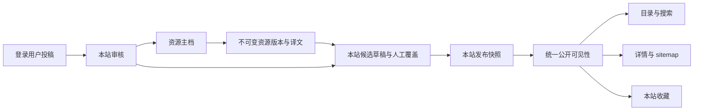

# P2 内容模型与操作协议

状态：实现已接入，最终验收见 [P2 交付](history/P2-FINAL.md)。安装与账号仍按 [P1 操作](P1-OPERATIONS.md)。P2 未变更固定 issuer、认证表或密钥存储方案。

## 内容如何发布



资源主档由站群管理员维护，保存 URL、类型、来源、中文/英文标题和说明。每次保存比较 `expectedVersion`，成功后写更高版本和不可变 `resource_revision`；内部备注单独保存。P2 建立通用网站类型，P4 增加仓库类型，见 [GitHub 操作](P4-GITHUB.md)。

每站、每资源、每语言分别有一份内容草稿和发布记录。草稿引用具体 `resourceVersion`，并含稳定 slug、分类、排序和本站覆盖字段。保存草稿不改变已有公开内容。发布把该资源版本和覆盖值解析成完整快照，记录历史、审计和幂等操作，事务提交后生效。

主档更新不会改写已有发布快照。后台“载入并比较主档新版”优先使用本站同语言已保存草稿，完整保留 slug、分类、排序和覆盖值，只采用新版 resourceVersion；没有有效草稿时才使用线上记录。首次发布前的已保存草稿也可比较。差异比较线上内容与生成候选，包含草稿本身的本站修改；维护者检查后另行保存、发布。请先保存本页编辑再比较，未保存 JSON 不会发送给比较接口。只读比较不推进写入版本；外部修改后的保存仍可能返回 409。缺少该语言完整主档时拒绝生成/发布，不拿默认语言假冒译文。详见 [主档新版比较 Review](history/MASTER-DIFF-REVIEW.md)。

P1 最小内容升级后保留版本 0 和原有标题、slug、可见性。原型没有存下的 URL/译文不会被推测；维护者补录主档后再采用 P2 编辑。示例安装为三站准备实际可编辑的版本化演示资源，重复 seed 不覆盖已有正式版本或草稿。

## 权限与管理界面

后台 `#resources` 管理主档，支持普通表单、完整 JSON、版本历史、按标识查找、分页和文件交换。主档查询、维护及首次跨站分发限站群管理员；站点编辑维护本站已分发内容、分类与审核。只读成员可查看授权站内容和受保护草稿预览；不能发布、下架或审核。

站点配置页“管理本站内容”进入 `#content/站点标识`。选择已有发布记录后编辑，保存保留当前选择。新分发填写资源标识与语言，再保存候选。内容草稿 JSON：

```json
{
  "resourceVersion": 1,
  "slug": "example-resource",
  "categoryId": null,
  "rank": 0,
  "overrides": {
    "title": "本站名称",
    "description": "本站说明",
    "seoTitle": "本站搜索标题",
    "seoDescription": "本站搜索说明"
  }
}
```

覆盖值缺失表示继承该资源版本；URL 也可在 `overrides.url` 覆盖。分类 ID 只能来自本站，排序较小者靠前。发布、保存同时检查当前发布版本和草稿版本；冲突时保留输入，不强制覆盖。一次发布重试须复用相同操作 UUID；不同目标或参数不能复用。

内容下架更改本站状态并增加版本，保留主档与历史；资源改为不可公开对所有站立即生效。分类停用或缺少对应语言名称会隐藏其公开资源，数据保留。已记录发布不一定符合当前公开条件，使用“检查可见性”查看停站、模块、语言、主档公开状态、分类、本站发布状态及主档更新提示。

管理资源、发布和投稿每页最多 100 条，提供分页；主档与发布历史接口最多返回最近 100 个版本。分类采用本站平铺分类及多语言名称，P2 不提供分类树或全文检索引擎。

同页切换主档/发布记录或继续编辑后，旧历史、差异、预览与诊断结果不会覆盖新选择；同时发起多个检查时，以最后一次检查为准。保存、发布或下架已经提交后，切换选择不会撤销后端操作，新编辑保留。

资源主档在同一目标保存期间继续输入时，只接续本次成功响应确认的版本，不覆盖后续输入；新建成功后锁定标识。外部版本变化仍会冲突，失败或响应不明时不推测服务端版本。保存成功但列表刷新失败会单独提示；规则与验证见 [主档连续保存 Review](history/RESOURCE-SAVE-REVIEW.md)。

内容草稿也接续本次成功响应确认的双版本：保存采用draftVersion，发布同时接续被消费后的草稿版本，下架只推进发布版本。三个写按钮共用忙碌状态，保留文本输入和选择。列表刷新不自动替换编辑基线；主动重选记录才采用列表版本。发布响应不明时保留原操作UUID，确认成功后换新UUID；不要更改原请求参数后冒充精确重试。详见 [内容双版本接续 Review](history/CONTENT-SAVE-REVIEW.md)。

预览读取已经保存的内容草稿。复现与验证见 [内容编辑 Review](history/CONTENT-EDITOR-REVIEW.md)。

分类保存、内容保存与投稿审核分别回填对应区域，保留其他表单的未保存输入。分类版本只推进到本次成功响应确认的版本，外部冲突仍须核对后重试。审核期间只锁当前投稿，接受后仍须另行发布。

“刷新发布记录”只更新当前分页列表，保留其他编辑内容。审核或内容操作已保存、但列表刷新失败时，使用此按钮重试列表，不重复提交已成功的审核。接受生成的草稿可能因排序落在其他页，按资源标识翻页查找。详见 [分类与审核 Review](history/CONTENT-MODERATION-REVIEW.md)。

资源检索、资源翻页和本站内容整页载入按工作区记录当前请求。只有最新请求可以替换页面；过期响应和错误不回写，新请求的加载状态也不由旧请求清除。切换后台路由会失效原列表请求。当前检索失败保留原列表和查询输入，恢复查找按钮，可再次尝试；这不代表已经发送到服务端的写操作被撤销。详见 [列表请求顺序 Review](history/CONTENT-LIST-REVIEW.md)。

## 公开查询与多语言

### 媒体与图片

资源草稿的 `overrides.image` 可引用本站媒体：`{ "mediaId": "<uuid>", "alt": "说明" }`。发布时验证媒体属于本站，快照写入 `publication.image`；`public_listing.image` 输出 `/media/<uuid>` 和 alt。媒体只允许 JPEG/PNG/WebP，单文件 10 MiB，最长边 12000、总像素 4000 万；服务器按魔数和尺寸校验，拒绝 SVG/GIF 和 MIME 欺骗。首版不做服务端缩放/裁剪，避免重新引入 `sharp`/libvips；上传原图，客户端可用 CSS/`loading` 控制展示。

公开 `/media/<uuid>` 仅在至少一条 `public_listing` 引用该图时返回 200，否则 404；响应为内容哈希 ETag、长缓存和 `image/*`。删除时若仍被线上记录或草稿引用返回 409。管理 API 和 UI 见 [媒体管理](P2-MEDIA.md)。

所有目录、搜索、详情、分类计数、sitemap 和收藏复用 `public_listing`。必须同时满足本站有效、资源允许公开、本站记录已发布、模块启用、站点启用该语言、标题完整、分类及分类译文可用。公开结果不含主档来源、内部备注、账号空间或草稿。

- `/` 与 `/{locale}/{catalogPath}`：目录、关键词和分类筛选、分页。
- `/{locale}/{catalogPath}/{slug}`：详情，外链只接受无用户名密码的 HTTP(S) URL。
- `/api/search?locale=zh&q=关键词&category=分类&page=1`：分页内容；返回 `total/items/page/limit`，每页默认 24、上限 100。
- `/api/items/{locale}/{slug}`：本站详情；不可见返回 404。
- `/api/categories?locale=zh`：仅包含有可见内容的分类及计数。
- `/api/catalog?locale=zh`：保留 P1 的精简数组接口，最多前 100 条；分页使用 search。
- `/sitemap.xml`：只收录当前可见的实际语言页面；超过 50,000 条明确报错，分片扩展留作容量工作。

搜索按本站已发布标题、说明和 SEO 文本进行不区分大小写的匹配；中文按字符、英文按词/字符混合。迁移 `006-search.sql` 启用 PostgreSQL `pg_trgm` 并建立 GIN 索引（需要数据库用户有 `CREATE EXTENSION` 权限，或由托管服务预装）；结果按标题/描述相似度、站点排序值和稳定 slug 排序。1–2 字短查询可能回退普通匹配，索引效果需按实际语言验证；10 万资源 p95 仍是目标，不是生产承诺。查询中的 `%`、`_` 会被替换为空格，不作为通配符。

详情 canonical 与 OG 仅使用已注册站点 origin，保留正确 HTTPS 端口。hreflang 只列本站同一资源可见的语言，sitemap 同样关联。缺失译文返回本站 404 和实际存在的其他语言链接。搜索/分类结果不索引；个人页禁止索引。管理 API、账号/会话/搜索接口为 no-store；公开目录页和静态资源使用 ETag 与短 TTL，权限及内容门控不等待配置缓存 TTL。

## M13a：富字段、标签和多分类

- **资源主档**：
  - 新增定价 `pricing`，取值为 `free`、`freemium`、`paid`、`trial`、`open-source`、`contact`；
  - 每种语言的译文可以加入 `tagline`（≤160 字）、`features`、`useCases`、`pros`、`cons`（每组最多 12 条，每条 ≤300 字）、`content`（Markdown，≤50000 字）和 `faqs`（最多 20 组问答）。这些字段都是可选的。
- **后台主档表单**：表单只编辑名称和说明，其余字段在完整 JSON 里编辑。修改表单不会再清掉 JSON 里的其他字段；以前重建 `translations` 时会丢掉它们。
- **本站标签**：结构和分类一样，按站点维护（标识、多语言名称、排序、是否启用），在后台“本站内容”页编辑，管理 API 为 `/admin/api/content/<site>/tags`。
- **内容草稿新增字段**：
  - `extraCategoryIds`：主分类之外的其他分类，最多 10 个，必须先设置主分类 `categoryId`；
  - `tagIds`：最多 20 个；
  - `overrides` 新增 `tagline`、`content`，以及媒体库图片 `logo`。

  分类和标签发布时都会检查是否属于本站。没有这些字段的旧草稿，保存和比较时结构不变。
- **发布快照**：分类、标签、本语言的富字段、定价和 logo 在发布时冻结。另外记录首次发布时间（重新发布时不变）和最近发布时间。迁移 `015-content-model.sql` 从审计日志补齐已有发布的时间，查不到记录时使用迁移时间。
- **可见性**：
  - 条目能否公开仍只看主分类，和以前一样；
  - 停用或缺少该语言名称的其他分类和标签，只是不再显示，也不能用于筛选，不会让条目下线；
  - 分类计数包含其他分类。
- **媒体**：被 logo 引用的媒体，和被封面引用的一样，不能删除；被已发布内容引用后，才能公开访问。
- **比较主档新版**：没有草稿、改用线上记录生成候选时，会保留其他分类和标签；差异列表新增 `details`、`logo`、`categoryIds`、`tagIds`。

## M13b：榜单与 AI 补全

- **本站榜单**：例如热门、编辑精选。每个榜单有多语言名称、可选的多语言说明、排序、是否启用，以及按顺序排列的资源标识（最多 100 个）。
  - 在后台“本站内容”页编辑，管理 API 为 `/admin/api/content/<site>/collections`。
  - 保存时会检查版本，并整体替换条目列表；资源必须存在。
  - 和分类一样，保存即生效，不需要发布。
- **公开显示**：每种语言只显示该语言当前可见的条目（`public_listing`），条目被下架后会自动从榜单里消失。
- **AI 富字段补全**：见 [AI 文档](P3-AI.md)。补全结果写成主档的新版本，各站按原来的流程比较、保存草稿、发布后才会上线。

## M14：对比页、替代品页、sitemap 与 RSS

- **对比页**：
  - 按站点和语言维护，在后台“本站内容”页编辑，管理 API 为 `/admin/api/content/<site>/comparisons`。两个资源标识按字母顺序组成 `a-vs-b`，保存时检查版本。
  - 勾选“发布”后，只要两个资源在该语言都可见，对比页就会公开；任一资源下架，对比页随之隐藏。发布时正文不能为空。
  - 可以先用“AI 起草”生成标题和正文，人工核对后再保存。
- **替代品页、sitemap、RSS**：都复用 `public_listing` 的可见性规则，见 [模板开发](TEMPLATE-DEVELOPMENT.md#m14程序化-seo)。迁移 `017-comparisons.sql` 新增 `comparison` 表和 AI 任务类型 `compare`。

## 收藏、投稿和审核

用户在 `/me` 查看本站当前语言的可见收藏、取消收藏、提交网站及查看审核结果。收藏主键包含 site_id、规范用户 UUID 和资源；独立站点各自登录；既有共享账号跨站登录后仍有各自收藏。

切换语言或分页后，旧列表及迟到错误不能覆盖当前选择；临时加载失败提供“重新加载”，只有未登录响应才提供登录入口。投稿期间继续编辑的内容在成功确认后保留，并提示当前编辑尚未提交；投稿成功但列表刷新失败会明确提示，重新加载只读取列表，不再次投稿。投稿及其后续读取期间阻止重复表单提交事件；成功确认立即显示，切换语言或只读恢复后仍保留。投稿和取消收藏交错时，提示归后开始的动作，旧动作错误不覆盖新提示。审核通过仅显示“已通过审核”，不推断是否已发布。交错响应与失败恢复的验证见[读者页面 Review](history/READER-PAGE-REVIEW.md)和[读者提交确认 Review](history/READER-COMMIT-REVIEW.md)。

投稿与收藏写入在事务中锁定用户及会话，并在取得身份行锁后用数据库当前时钟检查普通、绝对期限。投稿先等待限流业务锁再校验；排队期间已撤销、封禁或到期的请求返回 401。已获授权的事务先完成，撤销或封禁随后提交，后续请求再被拒绝。详见 [个人写入会话事务 Review](history/PERSONAL-TRANSACTION-REVIEW.md)。

投稿要求本站登录、启用的语言、完整标题/说明和有效 URL。每个用户每站每小时最多 10 条，数据库事务与锁限制并发。统计在 SQL 执行时按数据库当前时钟一次确定窗口，created_at 记录插入时刻，避免排队后沿用事务开始时间误判；共享账号仍按站点分别计数。详见 [投稿限流时间边界 Review](history/SUBMISSION-CLOCK-REVIEW.md)。客户端不能指定用户或账号空间。其他站和用户不能查询投稿。

审核必须携带当前投稿版本，只允许 pending → accepted/rejected。接受在同一事务创建资源主档和本站草稿，仍需显式发布；拒绝只保存审核状态与说明。重复审核返回冲突，不能创建重复资源。审核说明可由投稿者查看，不应填写内部秘密。

个人投稿 GET `/api/me/submissions` 支持可选 `page`（整数 1–100000，默认 1），仍返回数组，每页最多 100 条，按 created_at 降序、ID 升序稳定排序。个人页投稿/收藏各自翻页，语言切换仅重置收藏页；成功投稿将投稿历史返回第一页。满页可进入下一页，空页可返回；实时 OFFSET 分页不保证并发新增期间的跨页快照。详见 [个人投稿历史分页 Review](history/SUBMISSION-HISTORY-REVIEW.md)。

个人 API 为 `/api/me/favorites` 和 `/api/me/submissions`，不接受来自请求体的 site_id/user_id；POST 必须通过本站 Origin 和实时会话检查。收藏只接受本站当前可见资源；下架后隐藏收藏展示，保留收藏记录便于撤销和恢复，不泄露已下架内容。取消操作按资源保持等待状态，跨语言或列表重绘仍防止重复请求，不同资源分别解除等待。空列表页超出剩余总数时只读回到有效末页，保留投稿页及表单输入；自动纠正不会覆盖较新操作的提示。详见 [收藏跨重绘操作 Review](history/FAVORITE-REDRAW-REVIEW.md)。

## 文件与 CLI

资源 JSON 每份最多 100 条，HTTP/后台文件上限 256 KiB。后台按当前检索页导出：能装进一份时直接下载；超过上限时列出多个下载按钮，每份保留原有 schemaVersion 1，按原顺序完整覆盖该页，分别下载、检查和导入。按 UTF-8 字节同时核对格式化文件与封装后的导入请求，不能只按字符数计量。单条内容无法装入时明确报错，不静默丢弃。

每份导入独立事务；前一份成功、后一份冲突时，前一份不会回滚。尚未执行的文件保留原版本校验，须解决冲突后重试；这里不承诺跨文件整体原子。原始导出 API 与 CLI 仍返回当前页完整的一份 JSON，CLI 不经过 HTTP 的 256 KiB 限制；要交回后台时使用后台拆分导出或手工拆为有效独立文件。只导出已补录的主档，P1 无 URL 的版本 0 最小记录需先补录。它不导出内部备注、凭据、用户、会话或媒体，不代替完整备份。

更换或清空文件选择立即使旧内容失效；旧文件读取、检查成功或失败的迟到结果不能覆盖新选择。更换文件不撤销此前已提交的导入事务。导入成功后保留当前检索条件与页码。[文件协作 Review](history/CONTENT-EXCHANGE-REVIEW.md) 记录复现与验证范围。

```json
{
  "schemaVersion": 1,
  "kind": "resources",
  "resources": [{
    "id": "example-resource",
    "expectedVersion": 0,
    "public": true,
    "data": {
      "url": "https://example.com",
      "source": "manual",
      "translations": {"zh": {"title": "资源名称", "description": "资源说明"}}
    }
  }]
}
```

导入严格校验版本、重复 ID、字段和引用，先 dry-run。执行阶段仍重查版本；任何一条冲突或写入失败，整份文件回滚。已有资源内部备注保留，不被交换文件的空字段清除。导入仅生成主档新版本，不自动改变各站线上内容。后台执行时与主档保存及列表刷新互斥，完成后保留编辑器输入与原版本，仅更新列表；原文件不能重复执行，需明确选择下一份文件。列表读取失败保留导入确认，通过“刷新列表（保留编辑）”只读恢复。若当前编辑的主档已被导入更新，需比较并明确选择列表中的新版，旧编辑版本不会被静默推进，详见[主档导入 Review](history/RESOURCE-IMPORT-REVIEW.md)。移到空库时明确把条目的 expectedVersion 改为 0；原库更新须保留当前版本号。

```bash
pnpm --silent cli resources-export 1 > resources-page-1.json
pnpm --silent cli resources-check resources-page-1.json
pnpm --silent cli resources-import resources-page-1.json
pnpm --silent cli content-stage atlas example-resource zh candidate.json
pnpm --silent cli content-publish atlas example-resource zh 0 1 00000000-0000-4000-8000-000000000002
```

`candidate.json` 是 `{ "candidate": 上述候选, "expected": { "published": 0, "draft": 0 } }`。content-publish 的最后三个参数分别是当前发布版本、草稿版本和重试操作 UUID。所有数字均为例子，按后台当前版本填写。

后台 API `/admin/api/content/batch-publish` 接受最多 20 项 `{siteId,resourceId,locale,expected,operationId}`，逐项独立事务返回成功或失败；不伪装成整批原子发布。主档导入原子事务与跨站发布的逐站事务是两个明确的操作协议。
发布记录表对已有草稿的行提供勾选，站群管理员可“选择有草稿”后批量发布，单次最多 20 项；没有草稿的行不可选。每项仍是独立事务和独立操作 UUID，响应逐项显示成功/失败，失败项保留原草稿。批量按钮只对站群管理员显示，站点编辑仍按单条发布。交互与部分失败边界详见[内容批量发布 Review](history/BULK-PUBLISH-REVIEW.md)。

读者页“退出本站”在请求期间禁用并拦截重复事件，失败后恢复重试并保留未提交输入；成功后返回本站首页。认证接口错误同时支持 message，详见 [读者退出交互 Review](history/READER-SIGNOUT-REVIEW.md)。

目录收藏按资源拦截等待中的重复事件，不同资源分别恢复。收藏、投稿、取消收藏及退出共用提示归属，旧响应与旧写入后的刷新不能覆盖新操作提示；详见 [目录收藏与共享提示 Review](history/CATALOG-ACTION-REVIEW.md)。

读者请求收到 HTML 错误页时仍保留 HTTP 状态，401 给出登录入口，临时错误可只读重试。成功状态但响应无法确认时，保留输入并提示先核对记录；退出则提示核对登录状态，不自动重放写入，详见 [读者响应异常恢复 Review](history/READER-RESPONSE-REVIEW.md)。

## 工程约束与升级

增量迁移 `003-content.sql` 不改写 001/002，不删除旧数据。公开门控只定义一次；`check-boundaries.mjs` 同时检查 UI/模板依赖和绕开内容数据层的直接业务 SQL。静态检查是工程防误用措施，不是 SQL 权限沙箱。

内容发布无异步刷新依赖：快照、历史和审计在事务中提交，公开读取不缓存结果。P1 的配置发布仍沿用 outbox、任务重试与 5 秒配置 TTL。新增代码不引入外部抓取、邮件、垂直类型、媒体上传或模板 SDK。
